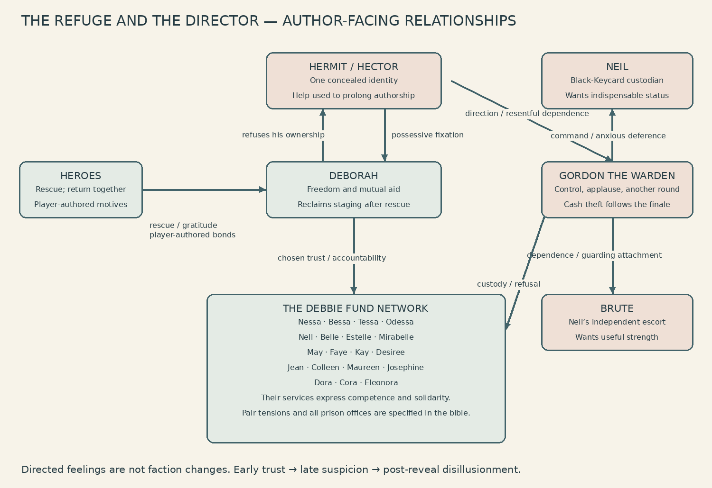

# The Refuge and the Director

LOD-LORE-001 — THE REFUGE AND THE DIRECTOR [AUTHOR-REQUESTED CANON; 2026-10-12]

This amendment authorizes the imported eight-role opinion mixer, the complete character/relationship bible, twenty staging chapters, all twenty women’s revised service conversations, and Deborah’s stolen-cash epilogue. It changes authored story and presentation only. Existing progression, deaths, factions, service claims, rewards, clocks, economy, boss routines, generation and release gates remain authoritative. Historical dialogue is superseded only by the exact script below.

THE EIGHT-PERSON ROOM
Ned Still — laconic absurdist head; final restraint/tonal authority. Quinn Keyes — interactive-comedy assistant head; runs and assembles the room. Roxy Bellows — club comic; bodily stakes and comic release. Perry Quibble — social-friction architect; incompatible wants. Mira Aside — outsider satirist; agency and coercion. Kit Glitch — meta-satirical gremlin; the production’s self-serving language. Bea Bunch — ensemble writer; continuity and distinct service voices. Ada Branch — adventure-story consultant; narrow clue-legibility veto. These are the same original fictional AI personas credited in Come and Knock on Our Door, not real contributors.

Opinion mixer procedure: diagnosis → six specialist passes → Quinn’s interactive assembly → escalation and character check → Ada’s clue veto → Ned’s final restraint. Actual passes are retained in repository docs/lore/room/. Roxy/Perry supplied the prison-as-employment conflict; Bea/Mira supplied the mutual-aid ensemble and directed relationships; Ada/Kit checked controls, revelation and Cash semantics. Quinn/Ned assembled the exact script below. Mechanics and clue meaning stay locked. A funny line cannot overrule a truthful control or promise a nonexistent reward.

STORY SYNOPSIS
The women built the Debbie Fund as a mutual rescue network. Gordon imprisoned the network; Hector secretly commandeered its refuge and supplies into a captive production. Heroes free the women one by one. The Hermit gives truthful practical counsel while increasingly exposing his possessive authorship. Level-20 Gordon defeat triggers the existing Hector reveal, Hector defeat unlocks the existing rescue, and Deborah takes over staging. Gordon then steals cash for the love of the game; the continued campaign is chosen opposition, not another prisoner or an undoing of rescue.

The containers promise movement but enforce confinement. The prison’s offices exaggerate real tactical roles into occupations. Its wild and discarded creatures have ecological appetites rather than a uniformly willing employment contract. The four rhyme quartets are working teams, not interchangeable sisters or compulsory romantic prizes. Heroes retain player-authored personal motives and bonds; class, origin, background, appearance and model do not impose a Half-Life biography. The Fund’s generosity is sincere, its actual resources and claim cadences finite.

RELATIONSHIP MAP — AUTHOR-FACING SPOILERS
Every edge is directed. The Hermit and Hector are one node with two presentations, not two people. Goals describe intention, desires emotional reward, predilections recurring habits; they are characterization, not new AI decisions. The diagram compresses the named network; the rows and defaults specify the complete directed map.

Default feelings for every otherwise unlisted ordered pair: Heroes → anyone is player-authored; network → network is solidarity with freedom to disagree; network → Heroes is gratitude without obligation; network → jail management is rejection of captivity; network → Hermit is provisional trust in early chapters, suspicion in late chapters, disillusionment only after the actual reveal; network → prison staff is wary opposition; management/staff → Heroes is hostile resistance; management → network is instrumental custody; management/staff → management is uneasy deference; ordinary staff → own office is practical affiliation, → other offices is competitive indifference; discarded/wild creatures → other creatures is territorial indifference unless a listed appetite or mechanic supplies an edge; named event roles → other roles is guarded neutrality. Every remaining pair is unacquainted curiosity/indifference, never invented intimacy. Self-feelings are the stated desire and corresponding insecurity. Explicit directed exceptions below override defaults; the reverse direction must use its own exception/default. These are author-facing feelings, not changes to damage, faction, targeting or NPC allegiance.

NETWORK AND CORE CHARACTER BIBLE

Nessa: provision the first return trip; wants dependable people, likes inventories; practical. "Pistol ammunition. The fund budgets for you coming back."
Bessa: make courage less lonely; wants company, likes noisy celebrations; expansive. "SMG ammunition. A little enthusiasm, properly contained."
Tessa: keep exits usable; wants direct answers, likes decisive solutions; terse. "Shotgun shells. For objections at conversational distance."
Odessa: spend resources deliberately; wants composure, likes precision; formal. "Revolver rounds. Six opportunities to choose your words."
Nell: redirect the jailer's supplies; wants competence acknowledged, likes requisition forms; dry. "AR2 ammunition. I have revised its intended recipient."
Belle: mend returning rescuers; wants permission to rest, likes ordinary comforts; warm. "Hold still. Your bravery has sprung another leak."
Estelle: remove lingering harm; wants prevention taken seriously, likes exact diagnoses; crisp. "Leave the affliction. You may keep the lesson."
Mirabelle: restore clear thinking; wants room to experiment, likes impossible questions; playful. "A little magic back. Try a better idea with it."
May: put tools into capable hands; wants her work used, likes repairs; industrious. "Gloves. Good hands deserve decent equipment."
Faye: make small commitments durable; wants promises kept, likes beautiful useful things; measured. "A ring. Small enough to forget; useful enough not to."
Kay: keep the group moving; wants open roads, likes brisk departures; buoyant. "Boots. Retreat is a direction, not a character flaw."
Desiree: protect judgment; wants people to listen, likes sharp presentation; elegant. "Headwear. Protect the source of your questionable ideas."
Jean: survive through preparation; wants reliability, likes layered plans; plainspoken. "A vest. Confidence is better with a lining."
Colleen: preserve dignity amid disaster; wants practical beauty, likes tailoring; wry. "Trousers. Let us face catastrophe properly dressed."
Maureen: take responsibility without martyrdom; wants shared burdens, likes solid workmanship; grounded. "A shield. You need not personally absorb everything."
Josephine: prepare for emergencies; wants foresight respected, likes labelled bottles; matter-of-fact. "A healing potion. Future you asked me to insist."
Dora: restore people fully; wants peace, likes unhurried breaths; gentle. "There. All healed. You are allowed one comfortable moment."
Cora: keep help circulating; wants accountability without cruelty, likes balanced books; economical. "Some $DEB from the rescue fund. Spend it getting home."
Eleonora: defend second chances; wants persistence without self-punishment, likes fresh starts; earnest. "One more life. A mistake need not become an ending."
Deborah: make the refuge belong to its people; wants abundance without compulsory performance, likes blunt truth; calm. "Abundance: one DFT each day. A gift need not be an audition."
Heroes: rescue and return together; individually authored by players; no imposed romance or biography.
Neil: maintain access control; wants indispensable status, likes procedures; bureaucratic menace.
Brute: protect Neil; wants clear commands, prefers direct physical responses; nonverbal loyalty, not a new speaking monster.
Gordon: keep the contest going; wants an appreciative audience, likes showmanship; theatrical vanity.
Hermit/Hector: keep directing everybody's role; wants exclusive authorship, likes telling people what their choices mean; genial counsel with possessive slips.

Named directed exceptions:
Nessa -> Bessa: fond concern about waste; Bessa -> Nessa: affection, impatience with counting.
Tessa -> Odessa: respects accuracy, dislikes deliberation; Odessa -> Tessa: admires resolve, worries about haste.
Nell -> Belle: protective esteem; Belle -> Nell: gratitude, concern about overwork.
Estelle -> Mirabelle: skeptical affection; Mirabelle -> Estelle: admires rigor, enjoys provoking curiosity.
May -> Faye: trusts her standards; Faye -> May: admires care made tangible.
Kay -> Desiree: likes her poise, teases her caution; Desiree -> Kay: fond exasperation, envies her ease.
Jean -> Colleen: trusts her practical artistry; Colleen -> Jean: affection, wishes she would enjoy her work.
Maureen -> Josephine: respects preparedness; Josephine -> Maureen: concern that protection becomes self-neglect.
Dora -> Cora: trusts her stewardship; Cora -> Dora: admires care, worries about depleted supplies.
Cora -> Eleonora: values her resolve, dislikes reckless spending; Eleonora -> Cora: respects restraint, defends second chances.
Eleonora -> Dora: gratitude; Dora -> Eleonora: protective hope without pity.
Deborah -> network: confidence and accountability; network -> Deborah: chosen trust, freedom to disagree.
Neil -> Brute: dependence disguised as command; Brute -> Neil: guarding attachment.
Neil -> Gordon: deferential resentment; Gordon -> Neil: impatience, instrumental appreciation.
Gordon -> Heroes: competitive admiration; Gordon -> Deborah/network: treats their refusal as an affront to his production.
Hector -> Gordon: values his spectacle, resents improvisation; Gordon -> Hector: enjoys direction until it limits applause.
Hector -> network/Heroes: possessive interest, confuses usefulness with consent.
Deborah -> Hector: lucid refusal of his authority; Hector -> Deborah: fixation on the person who rejects his casting.

BOSS AND COMPANION BIBLE
Gordon: maintain incarceration / indispensability / public discipline; resents Hector, fears Deborah, admires Heroes’ performance while devaluing their autonomy.
Chonker: own routes / notice / skating and bombs; envies Flightmeister, admires Daryl, resents heroes' defusing.
Felon: escape blame / relief from shame / bounces and ricochets; blames Gordon, envies Ollie, performs for heroes.
Melf: interchange identities / borrowed credit / imitation; covets heroes, admires Hector's disguise, distrusts Deborah's agency.
Ollie: acquire stock / security / shopping and hoarding; depends on Crystal, commodifies Felon, distrusts Deborah's sharing.
Crystal: enforce refreshment / gratitude / vending rituals; flatters Gordon, resents Ollie, envies Deborah's appreciation.
Daryl: preserve hazardous stores / recognition / chain reactions; loves Chonker's enthusiasm, envies Jane, resents Moshi's cleaning.
Sofa: keep everyone stationary / being needed / reclining and territorial furniture; disdains Marion, covets Deborah's company, resents departing heroes.
Marion: dominate circulation / precedence / hammer blows and traffic; hates Conan's closures, mocks Sofa, admires Brute.
Button: enforce participation / voluntary compliance / courses and decoys; admires Hector, depends on Gordon, resents careful heroes.
Ray: sustain pressure / acknowledgment / heat and valves; feels exploited by Hector, envies Jane's relief, resents Moshi's demands.
Cornette: complete extraction / permission to stop / drills and strained retreats; fears Gordon, resents Hector, trusts Moshi's care.
Moshi: erase cycle evidence / clean start / drains and spinning; pities Cornette, resents Daryl, mistrusts Rank's records.
Chuck: supply the set / worth beyond output / timber displays; relies on Jane yet takes billing, resents Rank, believes Hector's last-rebuild promise.
Jane: control pressure / skilled-worker credit / cylinders and venting; protects Chuck while resenting subordinate billing, distrusts Daryl, understands Ray.
Rank: classify everyone / unquestioned record / drawers and queues; serves Gordon, reveres Hector, hates Deborah's self-definition, discounts Neil.
Flightmeister: control apparent sky / superiority / patrols and strafing; scorns Chonker, rivals Mooky, fears heroes' beacon use.
Conan: dictate direction / obedience / detours and closures; hates Marion, admires Button, resents heroes' mutual assistance.
Joilette: monopolize relief / privacy / occupation and Cleaner gatekeeping; discounts Neil, rivals Moshi, resents heroes' persistence.
Mooky: equate scale with authority / dignity / cannons and patrols; fears Hector's belittling name, envies Flightmeister, dismisses Brute.
Hector: prolong authorship / indispensable intimacy / helpful selective omissions; possessive toward heroes, jealous of Deborah, dependent/contemptuous toward Gordon.
Deborah: restore mutual aid / autonomy / concrete names; grateful to heroes, angry with Gordon, refuses Hector's ownership.
Neil: survive assignments / notice / evasive work routines; fears Joilette/Rank, envies heroes' mobility.
Brute: exercise useful strength / respect / charges; admires resolve while serving hierarchy.
Heroes: rescues and survival; motives and relationships remain player-authored.

ALL 63 ORDINARY ENCOUNTER IDENTITIES
Custodians: goal contain prisoners; desire Gordon's approval. Shambler persists, Runner rushes, Soldier drills, Sniper waits, Watcher observes, Seeker commits, Gaoler freezes, Silencer suppresses, Repulsor repels, Sentry holds ground. Edge: fear Gordon; resent mobile heroes.
Information office: goal make confinement legible; desire Hector's recognition. Relay links, Lacemaker crosslinks, Censor restricts, Surveyor measures, Listener overhears, Screenwright screens. Edge: admire Rank; mistrust Deborah's independent testimony.
Discipline office: goal punish deviation; desire unquestioned order. Halter interrupts, Pacer checks movement, Exactor exploits conditions, Pavise reacts defensively, Repriser retaliates, Redliner overcommits. Edge: admire Button; despise Marion's exceptions.
Personnel office: goal preserve useful staff; desire belonging. Interposer guards, Mourner mourns, Stitcher repairs, Bulwark protects, Cantor rallies, Absolver cleanses, Siphoner drains, Accumulator replenishes. Edge: depend on Rank, pity Cornette, resent heroes breaking formations.
Routing office: goal channel traffic; desire predictable space. Outrider isolates, Conductor links, Towline pulls, Trailmaker retreats, Censer carries hazards, Wirewright wires, Snarer traps, Cordon encloses, Pincer pursues, Harrier harasses, Waylayer ambushes. Edge: admire Conan, resent Marion.
Weapons office: goal maintain damaging spectacle; desire technical distinction. Fusilier crossfires, Bombardier saturates, Caromer banks, Reeler returns, Forker splits, Flamer burns, Big Crab burns, Arc Caster arcs, Beam Sweeper sweeps, Razor dives. Edge: envy Flightmeister; admire Daryl.
Discarded bodies: goal persist despite disposal; desire acknowledgment. Afterburst leaves consequences, Carrion feeds, Reaper sweeps, Drubber doubles, Fencer feints, Shy avoids sight, Climber climbs, Bioblaster contaminates, Nodule occupies, Lurker waits. Edge: resent Rank's DECEASED drawer, distrust Moshi's erasure. This language does not canonize resurrection.
Neil/Brute retain individual rows above. Multiple instances share archetypal tendencies, not one physical identity.
Event identity: Game Master, vendors, Wounded Scavenger and Life Underwriter retain existing role names. A Hermit likeness is a service representation, not proof Hector teleports or personally operates every event. Do not invent extra actors to explain props.

Additional event-role motives: Game Master wants to test equipment knowledge, desires a correct performance, prefers wagers over charity; treats Heroes as contestants and admires the Director’s control, without confirming the avatar’s physical identity. Wounded Scavenger wants treatment, desires survival with dignity, prefers practical barter; guarded gratitude toward Heroes and distrust of prison authority. Life Underwriter is an institutional role embodied by the existing cash-register prop, not an added person: it wants chances converted into accounts, desires measurable risk, prefers contractual language; instrumental regard for Heroes, ideological opposition to Eleonora’s second chances. Debbie vending and service machines remain props whose institutional voice offers displayed exchanges; no invented person, hidden sentience, new quest or new vendor dialogue is implied. Skeleton Blockade actors and hostile fallen-Hero/Soldier copies remain distinct from the returned teammate: the latter is a stolen likeness, not their returned soul. Summons and boss-created duplicates have encounter-owned instrumental allegiance, not new rescue characters. Cash is stolen money in the existing briefcase objective, never a person.

COMPACT GOAL / DESIRE / PREDILECTION COVERAGE
The seven office paragraphs above explicitly assign each of the 61 ordinary archetypes its office goal/desire and individual listed predilection; Neil and Brute complete the production count of 63. These offices are lore categories, not new runtime roster or spawn weights. Jane remains Chuck’s companion; Gordon remains the same person at 1 and 20 and in the existing endless policy. Named rows override office defaults.

EXACT HERMIT SCRIPT — STAGING FOR DUNGEONS 1–20
The chapter is indexed by the upcoming Dungeon Level, not character Combat Level or number of times E is pressed. At Level N he discusses that level’s imprisoned woman; the previous rescue is already home. No conversation is mandatory for deployment. Reopening repeats the chapter without advancing it. Late joiners receive the current chapter; there is no global read cursor and no new persistent reward/reading service.

Dungeon 1 — A refuge, provisionally
Welcome to the refuge. Gordon the Warden has imprisoned the women who kept the Debbie Fund running. Twenty women, twenty rescues. Nessa is first; Deborah is last. They pooled supplies so nobody had to survive alone. Gordon has a different idea of cooperation: everybody does what Gordon says.

Default controls: WASD moves; mouse aims; Space jumps; Ctrl crouches; Shift sprints. Left mouse attacks, R reloads, right mouse casts selected Magic—or drinks a held Healing Potion. E uses the object you face. P opens your Character Sheet: choose a Class and your Level-1 Feat. O opens Equipment; I opens the Spellbook; L opens the Die Log. Q or M toggles the map, which spends Magic. The Manual and Options are in the Player Menu; Always Run changes what Shift does.

Take your first weapon from the pedestal, then use the blue portal when ready. The first Hero to deploy starts the thirty-minute collapse clock, before any Time Management allowance. Staying here will not pause it for friends already inside. Menus do not pause the world.

Follow Red Keycard, Red Gate; Blue; Yellow; then find Neil and his Brute escort. Neil carries Black. Beyond Black Gate, defeat Gordon, collect the Jail Key, open the chamber and reach Nessa. Defeating a boss alone is not a rescue. Come back and talk to me before each new dungeon. I like to know how the story is going.

Dungeon 2 — The cost of coming home
Nessa is home; Bessa is next. Nessa counts the ammunition. Bessa insists courage needs company. They argued about the noise, then agreed nobody should have to make it alone. That was the Debbie Fund before it became an excellent excuse for a prison.

Chonker the Honker claims every route his wheels can reach. He envies the Flightmeister his sky. Territorial ambition is wonderfully portable; even a very small tyrant can occupy a large room.

The people you bring back will stay in this refuge and offer their own help. Nessa supplies pistol rounds if you have the matching weapon. She is preparing for your return, not settling a debt. A useful distinction. I try to make it, occasionally.

Dungeon 3 — Emergency stores
Tessa kept the emergency stores. Preparation, she said, is optimism with pockets. Bessa wanted everybody invited; Tessa wanted an exit nobody could obstruct. The Warden confiscated both approaches. He dislikes supplies in the wrong hands—particularly hands that can open a door.

Felon the Melon is very anxious to escape the description on his own nameplate. He has confused evading blame with setting somebody free. Watch the committed bounce; shame is not his only means of changing direction.

The Fund was meant to get people out. Gordon calls it a competition. Competitions have another round, you see. A rescue has an end. Less reliable entertainment.

Dungeon 4 — A name of your own
Odessa taught the supply team to choose its shots. Tessa calls that hesitation. Odessa calls Tessa's method an announcement. Neither has ever persuaded the other, which is how I know they are still people rather than roles.

Melf the Yourself prefers copies. He borrows a Hero's strengths without the inconvenience of becoming that Hero. If you meet your own likeness, do not confuse recognition with allegiance.

This place is full of familiar faces doing unfamiliar work. An appearance is not a biography. The name you choose, the company you keep, the person you return for: those make a less convenient inventory. I have always preferred convenient inventories.

Dungeon 5 — Orders and excuses
Nell can read an order and tell you where the excuse begins. She redirects the jailer's ammunition into your AR2. Neil is somebody else: our mobile Black-Keycard custodian. The names are similar. Their principles are not.

Neil needs the Brute's protection, although he calls it supervision. The Brute prefers an instruction with a visible destination. Neil carries Black; defeating his escort is useful, but it does not replace finding the carrier.

Ollie the Trolly has accumulated enough goods to mistake possession for safety. Crystal Bepis supplies him and resents his demands. The Fund's alternative was to let things circulate. Gordon regarded circulation as a breach of custody.

Dungeon 6 — Care without an audition
Belle treats a wound before asking how it happened. Nell worries she will wear herself out. Belle worries Nell will mistake being indispensable for being well. Their disagreements are remarkably hard to confiscate.

Crystal Bepis expects gratitude on command. Her refreshment is not kindness merely because it arrives with a thank-you. Belle's help has limits, but she does not demand a pleasing performance of suffering before she offers it.

Gordon wanted the Fund to select the deserving. Deborah asked who would select the selectors. That was the first meeting he chose to adjourn with a locked door.

Dungeon 7 — What an injury means
Estelle removes the labyrinth's ailments. She and Mirabelle quarrel about what is possible; Estelle insists an experiment ought to leave somebody healthy enough to enjoy the result.

The prison has a staff for everything: guards to hold you, callers to gather hunters, attendants to mend their allies, and creatures that feed on what the others leave. Some obey. Some merely thrive here. A shared enemy does not make them a shared conscience.

Daryl the Barrel wants his scorch marks remembered. Estelle wants injuries treated before they become a person's whole description. I find her distinction inconvenient. A scar explains a character so quickly.

Dungeon 8 — The price of knowing
Mirabelle restored Magic for the Fund's rescuers. She says a resource is not a moral rank: being empty does not make you less worthy. Estelle approves the sentiment and objects to how frequently Mirabelle tests it.

Your map spends Magic while open. Your equipment and held throwable can affect what you can cast; consult the Spellbook and Manual rather than treating a failed cast as a prophecy. This refuge was built for preparation, not interpretation.

Sofa King Dangerous offers the sort of comfort that keeps you precisely where he wants you. A seat can be restful. A seat you cannot leave is another kind of cell. Deborah was very exact about the difference.

Dungeon 9 — Hands that built this
May supplied the working hands. Faye checked the small fittings; Kay kept the routes moving; Desiree kept everybody's judgment from being treated as an optional accessory. A network is rather more troublesome to seize than a treasury, so Gordon seized the people instead.

Those containers once meant movement: somebody expected a shipment to arrive somewhere. Now the prison rearranges the routes and calls another destination an achievement. May asked who was meant to receive all this effort.

Marion the Carbarian considers every crossing his right of way. He despises Conan's closures. Neither imagines a road that belongs to the people using it. May would have built one.

Dungeon 10 — A circle, not a leash
Faye kept the Fund's promises. She likes a circle because it can hold people together; she dislikes it when somebody decides that means keeping them inside. May trusts her standards. Gordon trusts nothing he cannot lock.

Button for Punishment believes a person who presses a button has consented to everything behind it. Read his instructions carefully. You may be participating in a trap without agreeing with its author.

You have returned enough times that the refuge has begun to feel inevitable. It is not. Somebody made it. Somebody stocks the pedestal. Somebody benefits when you enter the portal. Faye used to ask all three questions. A rather exhausting woman.

Dungeon 11 — The road out
Kay prepared routes out. Desiree called her hasty; Kay called Desiree exquisitely delayed. They both wanted everybody to arrive alive, which made the dispute productive. Gordon prefers disputes that keep people apart.

Ray D. Aitor maintains the prison's pressure. Jane the Propane understands what happens when useful labor is mistaken for an inexhaustible supply. They would have a great deal to discuss if their employers allowed discussion.

The walls change, but the purpose need not. Find the next person. Bring her back. You are permitted to want an ending even if the labyrinth has acquired a taste for continuations.

Dungeon 12 — The casting office
Desiree recorded what each person could do, not what each person was worth. The Director's paperwork is less precise. It turns a skill into a part, then calls somebody difficult when she wants to do something else.

Cornette's drills hurt. Pain has become evidence that she is working hard enough. Moshi pities her; the management calls that unprofessional. When Cornette draws back, give her room. Her suffering does not make her attacks harmless.

Yes, there is a Director. Every production has one. You need not meet him to finish today's work. I would hate to distract you from a useful task with an interesting question.

Dungeon 13 — A refuge left standing
Jean wanted everybody protected against consequences. Colleen insisted protection should still fit a person. They made practical things without making their recipients interchangeable.

Moshi the Washy cleans away the evidence of each cycle. She envies Deborah's willingness to remember. A clean floor can be a kindness; a clean record can be a very efficient lie.

The Fund's stock survived the seizure. So did this refuge. So did an exceptionally well-informed old man with a weapon ready for every new Hero. Jean would call that a pattern. I prefer the word fortunate.

Dungeon 14 — Who gets the credit
Colleen hates a uniform that makes its wearer disappear. Chuck Chuck Bo Buck supplies timber for the set; Jane the Propane keeps him working. He takes the headline. She takes the pressure. Their quarrel is not quite as amusing from Jane's side.

The people you rescue are not prizes with voices attached. They had work, friends and objections before you found them. Colleen will offer trousers because she chooses to make something useful—not because the next scene requires a grateful woman.

I told the Director that difference could be preserved. He agreed it was excellent characterization. I am not certain he heard the objection.

Dungeon 15 — Someone else’s bruises
Maureen kept the shields ready. Josephine kept asking whether she had saved anything for herself. Protection is admirable until everybody else starts budgeting for your willingness to be hurt.

Rank and File would prefer us all in a drawer. Neil thinks his position makes him essential; Rank considers him replaceable paperwork. Destroy the pending work before it becomes another problem. Being documented is not the same as being heard.

I once called Maureen cautious. She asked why my plans always required somebody else's bruises. I gave her a better line. She refused it. Some people make direction unnecessarily personal.

Dungeon 16 — A useful emergency
Josephine packed a Healing Potion for the emergency she hoped you would never have. Maureen liked that kind of optimism. I used to think a supply wasted on an uneventful journey was a missed opportunity.

The Flightmeister controls the apparent sky. Height is his preferred proof of importance. He and Little Mooky disagree about which distance makes a person look largest. Neither enjoys being brought within reach.

I may have encouraged the danger. A little tension sharpens a story; a returning Hero makes a satisfying scene. Josephine asked whether I could enjoy the return without arranging the injury. I have been considering that question for longer than you would think.

Dungeon 17 — Permission to rest
Dora believes healing is not payment for being interesting. Cora worries about the supplies; Dora worries about what happens when a ledger becomes a reason to withhold care. They keep talking. That was how the Fund worked.

Conan the Cone sets the permitted directions. Marion resents his closures; Button admires his routes. Keep an escape available, including for a friend. Cooperation should not mean following the one person who claims to know where you belong.

I used to tell Dora that suffering gave a legend weight. She asked whether I meant the legend, or the person carrying it. She always made silence feel like an answer.

Dungeon 18 — The missing author
Cora kept the rescue fund's accounts. The Debs and tokens are our local game records; a cash bag is the dungeon's stolen-cash objective. They are not interchangeable entries, and none is a claim on money outside this world.

Gordon stole resources. Somebody else stole the narrative: who needed rescuing, who deserved credit, how many obstacles made the return feel earned. Joilette the Toilet even made relief something you had to petition for. Cora asked why help always had an administrator standing in front of it.

Deborah wanted a refuge people could leave. The Director wanted a refuge people would always need. I have repeated his version so often that it sometimes arrives in my own voice.

Dungeon 19 — The understudy
Eleonora defends another chance. Cora calls it expensive; Dora calls it human. Eleonora says both are reasons to take care with it, not reasons to deny it. Her reserve-life gift still has its ordinary limit. Hope is not a promise of immortality.

The labyrinth can make a hostile skeleton copy from a fallen Hero or Soldier. That copy is not the friend who returns to you. Other skeletons have other origins. A likeness can carry a weapon without carrying a person's allegiance.

Little Mooky hates the name. The Director gave him a small one so he would keep trying to fill it. I liked that trick. Copies, roles, another chance at the same scene—I have been rather fond of things that are easy to direct.

Dungeon 20 — The last objection
Deborah founded a refuge, not a casting office. She wanted people free to leave, to stay, to disagree. Gordon called that disorder. The Director called it an ending. I thought a legend needed somebody arranging the danger. Deborah thought people already had enough.

Gordon has returned with company. Watch his openings and the warnings; a likeness is not necessarily the real Warden. His defeat will not finish this last encounter. Something behind the production still objects to your reaching the Jail Key. Follow the fight's instructions, then open Deborah's chamber and reach her.

You have learned almost everything I taught you. Why does that sound so much like goodbye? If she asks who kept the refuge supplied, tell her I did. If she asks why it needed supplying so many times... let her ask me.

ALREADY-REVEALED HECTOR — CONDITIONAL OVERRIDE
If the existing authoritative HectorRevealed flag is true before Deborah succession, use the truthful override below instead of the unrevealed chapter. Never send the Hector speaker, name, or this text before that flag. After legitimate Deborah rescue, the guide is Deborah only.
The disguise is over. Hector the Director: Hermit was the quieter credit. I gave you real help, and arranged that you would keep needing it. Deborah says that is not the same as setting someone free. The fight is not settled by this conversation. You still have a choice to make in the court.

EXACT DAMSEL CONVERSATIONS
Use the existing deterministic current-dungeon/character-index variant selector. Each E interaction still attempts only the existing service, including ordinary cooldown/eligibility/full-inventory rules. Conversation remains available when a gift is already claimed; the actual receipt, never the invitation, states whether anything was granted. These lines invite the service; they do not claim a successful transaction.

Nessa
Variant 1: Pistol ammunition. Bessa calls my inventories dreary. Yet everyone likes discovering that dreary has saved them a magazine.
Variant 2: Bessa plans the celebration; I count who gets home. Here is pistol ammunition. Give me another person to count.
Variant 3: Tessa prefers decisive exits. I prefer stocked ones. Take this pistol ammunition; perhaps you can satisfy us both.

Bessa
Variant 1: SMG ammunition! Nessa says enthusiasm requires a budget. I say a budget should occasionally sound enthusiastic.
Variant 2: Nessa worries I spend too freely. She means ammunition, mostly. Take some for your SMG; spend it getting everybody home.
Variant 3: Belle promised we could celebrate once nobody was bleeding. SMG ammunition for you. I am doing my part to shorten the guest list of emergencies.

Tessa
Variant 1: Shotgun shells. Odessa likes six carefully chosen arguments. I prefer the discussion to conclude.
Variant 2: Odessa says patience wins disputes. Certainly. Take these shotgun shells in case patience encounters a locked personality.
Variant 3: Nessa has counted these shotgun shells twice. I trust her. I trust you to make the third count unnecessary.

Odessa
Variant 1: Revolver ammunition. Tessa calls deliberation a luxury. Precision is how I keep a luxury affordable.
Variant 2: Tessa and I disagree about volume, never about getting people home. Six persuasive revolver rounds should clarify that distinction.
Variant 3: Nessa has impeccable accounts. I admire a person who can tell a missing round from a missing promise. Revolver ammunition, with my confidence.

Nell
Variant 1: AR2 ammunition. Gordon filed it under security. I have revised the beneficiary. Belle approves of changes that produce fewer patients.
Variant 2: Belle says I cannot requisition a decent night's sleep. An intolerable gap in the system. I can, however, supply your AR2.
Variant 3: Neil dislikes unauthorized departures. I dislike his definitions of authorization. These AR2 rounds have changed departments.

Belle
Variant 1: Hold still; let me mend some of that damage. Nell treats rest like a missing form. I keep telling her she already qualifies.
Variant 2: A little healing. Nessa counts supplies; I count people who return. We agree that you should improve our figures.
Variant 3: Nell would requisition sunshine if she found the right department. Until then, come here. I can at least tend those wounds.

Estelle
Variant 1: Let me clear those afflictions. Mirabelle calls them interesting. Interesting is a condition I prefer to study from across the room.
Variant 2: Mirabelle and I agree that mysteries deserve attention. We disagree about keeping them in your bloodstream. Leave the afflictions with me.
Variant 3: Belle patches the damage; I remove its lingering acquaintances. We make a useful distinction. Come here for a cure.

Mirabelle
Variant 1: A little magic restored. Estelle says curiosity needs supervision. I maintain that supervision could use a little curiosity.
Variant 2: Estelle has never met a mystery she would not label. I love her for it. Here is some magic for the unlabelled ones.
Variant 3: Nell finds supplies where nobody thought to look. I try the same approach with ideas. Take a little magic; surprise us both.

May
Variant 1: Gloves for you. Faye checks the finish; I check the seams. Between us, we prefer useful things to grand promises.
Variant 2: Faye says care should be visible. I say it should survive use. These gloves are our modest argument in both directions.
Variant 3: Kay will wear out any road you give her. I admire that. Take these gloves; there is still work worth putting your hands to.

Faye
Variant 1: A ring. May makes care tangible. I like that about her; so many people only make it audible.
Variant 2: May says small things deserve good workmanship. A ring makes a remarkably portable reminder that I agree.
Variant 3: Cora insists that a promise is not an asset. Quite right. Take this ring; I prefer giving you something that actually exists.

Kay
Variant 1: Boots! Desiree calls my departures abrupt. I call them departures. We both prefer them to appointments with Gordon.
Variant 2: Desiree has the poise; I have the route out. Take these boots and borrow whichever quality the next room requires.
Variant 3: May checks every stitch before I wear a pair out. She deserves a more patient friend. Boots for you; perhaps you qualify.

Desiree
Variant 1: Headwear. Kay trusts her feet to get her out of trouble. I prefer protecting the part that decides where they go.
Variant 2: Kay has taught me that a brisk exit can be perfectly dignified. Take this headwear; let good judgment travel with you.
Variant 3: Colleen understands that dignity can be practical. Gordon understands neither word. Here is some headwear for your next encounter with his opinions.

Jean
Variant 1: A vest. Colleen says useful clothes may also be handsome. I will concede the point once you come back wearing them.
Variant 2: Colleen has an eye for a good line. I have an eye for what might get through it. This vest is a compromise we both like.
Variant 3: Maureen calls protection a shared responsibility. Sensible woman. Take a vest; sharing begins with having something to contribute.

Colleen
Variant 1: Trousers. Jean thinks a garment's finest quality is surviving. I agree, but I refuse to make survival look apologetic.
Variant 2: Jean hides excellent workmanship beneath talk of necessity. Take these trousers. I am determined that somebody should appreciate the result.
Variant 3: Desiree and I believe dignity is portable. Gordon appears to believe it requires a spotlight. Trousers for the less expensive interpretation.

Maureen
Variant 1: A shield. Josephine worries I take on too much. I intend to prove I can pass something useful to another pair of hands.
Variant 2: Josephine prepares for emergencies; I try to make them smaller. Take this shield. We would both appreciate your cooperation.
Variant 3: Jean believes in an extra layer. I believe in something between you and the blow. A shield should settle our entirely friendly argument.

Josephine
Variant 1: A healing potion. Maureen says she can take another blow. I would prefer she discover another hobby.
Variant 2: Maureen looks after everybody else. Somebody has to remember her, too. Here is a healing potion; preparedness is a form of affection.
Variant 3: Belle likes an unhurried recovery. So do I. This healing potion is for occasions when the labyrinth declines to share our taste.

Dora
Variant 1: Let me heal you fully. Cora keeps the fund solvent; I try to keep its people whole. Both accounts matter.
Variant 2: Eleonora believes in second chances. I believe they should begin with fewer wounds. Come here; let me restore your health completely.
Variant 3: Cora worries that I spend myself too freely. She is looking after me, so I listen. Now let me give you a full healing.

Cora
Variant 1: Some $DEB from the rescue fund. Dora reminds me that a balanced account means little if nobody survives to use it.
Variant 2: Eleonora and I disagree about acceptable risks. We agree that people deserve another try. Take this $DEB; make yours a considered one.
Variant 3: Faye likes promises you can hold. I like aid you can actually spend. Here is your $DEB disbursement; no speech required.

Eleonora
Variant 1: One more life. Cora calls caution a virtue. I agree; I simply refuse to let a mistake become somebody's entire biography.
Variant 2: Dora makes a new start feel possible. I try to make it available. Take another life, and be kinder to yourself this time.
Variant 3: Cora wants every chance accounted for. I want every person to have one. Another life for you; help us both sleep easier.

Deborah
Variant 1: The Hermit was Hector, our self-appointed director. He took a refuge built by people helping one another and cast us as his supporting characters. You broke that arrangement. Nessa's supplies, Belle's care, Cora's accounts: those were always their work, freely offered. This refuge belongs to its people now. Gordon has sent an encore: he is stealing the fund's cash because he cannot bear the curtain coming down. Cash means stolen money, not another captive. Beyond Level 20, recover the bags and bring our resources home. Separately, Abundance remains your gift: one DFT each day. Nobody owes Hector another performance.
Variant 2: Hector hid behind the Hermit's smile. Useful advice did not give him ownership of anybody's story. Our network made this place a refuge; you helped us reclaim it. Cora will keep the books, Dora will keep caring, and the others will offer their own gifts on their own terms. Gordon, predictably, has chosen an encore. His letter says he is stealing cash now. There is no person called Cash to rescue: from Level 21 onward, secure the stolen bags. The rescue story is won; recovering our resources can continue. Abundance is separate: one DFT each day. A gift is allowed to be a gift.

CONTINUATION AND REVELATION SAFEGUARDS
Do not label the Hermit Hector before the existing Level-20 reveal. Do not treat boss defeat as rescue or skip Gordon → Hector → Jail Key → Deborah. Retain Gordon’s existing post-rescue letter, including his love-of-the-game cash theft. Deborah’s epilogue is available on every eligible talk, including already-claimed or unavailable Abundance; it never issues a pedestal gift or additional cash/token. Cash recovery count is not wallet cash conversion. Daily Abundance remains ranked/account/cooldown/cap governed. All existing service cadences, first weapon and repeat gifts remain untouched. Dialogue neither pauses an active dungeon nor extends its timer. No new map, boss selection, music, cinematics, voices, romance, actors or economy mechanism.
